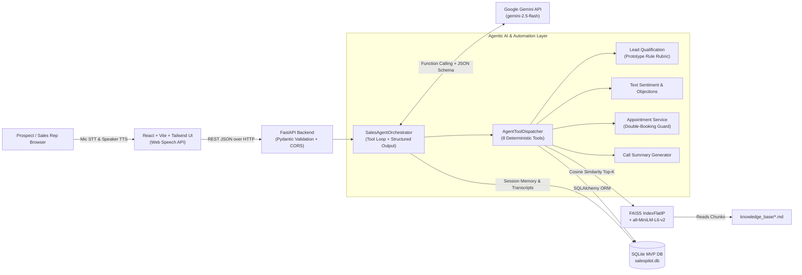
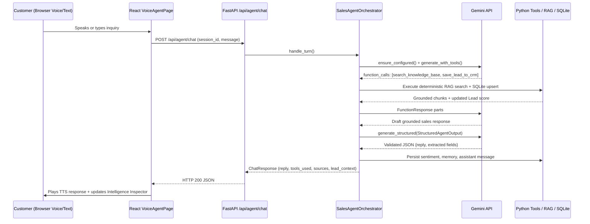
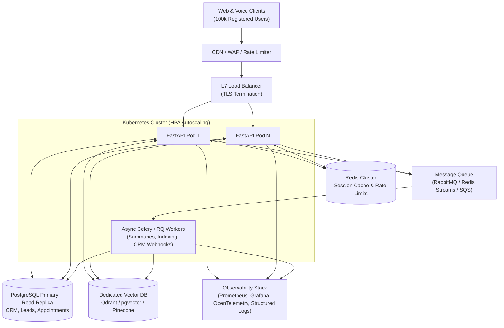

# SalesPilot AI — System Architecture Diagrams

## 1. MVP End-to-End Architecture

---

## 2. Autonomous Tool-Calling & Booking Sequence

---

## 3. Target Production Architecture (100,000 Registered Users)

